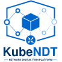
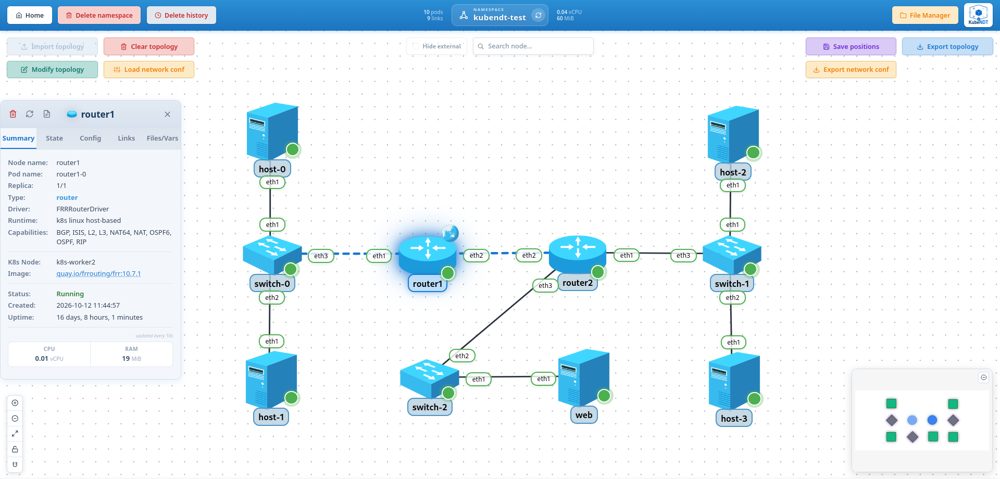

# KubeNDT

<p align="center">
   
</p>

<p align="center">
   <a href="https://doi.org/10.5281/zenodo.21276320"></a>
</p>

> Last reviewed: 28 Oct 2026

**KubeNDT** is a platform for deploying and operating virtual network topologies on Kubernetes.

You define your topology as a JSON file (nodes, links, images, replicas) and KubeNDT deploys it into your cluster and shows it as a live graph in the dashboard. From there you can apply a network configuration (IP addresses, routes, NAT, OSPF, bridging…) across all nodes at once, open a shell into any of them, add or remove nodes on the fly, and monitor interface states in real time. Any container image that ships `sh` and the `ip` command works as a node (see Requirements).

Network configuration is abstracted through a **driver and capability system**: regardless of what image a node runs, the same declarative actions apply. The driver takes care of translating them into the right commands for that node type.



## License

Copyright (C) 2026 Emilio García de la Calera Molina

**KubeNDT** is licensed under the GNU Affero General Public License v3.0 or later (AGPL-3.0-or-later).

You may use, modify, and distribute this software under the terms of the AGPL-3.0-or-later license.

Commercial licensing may be available in the future.

For inquiries, contact: er.garciadelacalera@gmail.com

See the LICENSE file for full details.

### Third-party assets

KubeNDT bundles a small set of third-party SVG icons in its frontend. See [ATTRIBUTION.md](./ATTRIBUTION.md) for the full list of authors, collections and licenses (CC BY 4.0, OFL).

## Key Features

### Core Capabilities

- **Real-time topology visualization** using React Flow with drag-and-drop node positioning
- **Multi-instance nodes** via StatefulSets with configurable replicas (e.g., 3 routers running simultaneously)
- **Virtual networking overlays** powered by Meshnet CNI for custom L2/L3 connectivity
- **Meshnet health awareness** - the dashboard shows whether the Meshnet dataplane is running (per cluster and per node), and blocks a deploy when it is missing so topologies don't come up with unwired links
- **Link realization** - the link panel shows whether Meshnet wired a link as a veth pair (both ends on one worker) or a VXLAN tunnel (across workers) and which worker each end runs on, also available through `GET /network/links/{namespace}` for scripts
- **Several addresses per link end** - `localIp` and `peerIp` take one address or an array (dual stack, a second IPv4): the first is wired with the link, the rest are set by the platform after wiring and on every recreation, and the panels list every address of an interface
- **Link MTU** - every link gets the same MTU once it is wired, 1450 by default and `KUBENDT_LINK_MTU` to change it. A link can declare its own `mtu` in the topology or through the `links` section of a configure request
- **Modular driver architecture** supporting different node types (hosts, routers, switches) with extensible capabilities
- **Interactive terminal shell** with WebSocket for real-time pod access
- **Dynamic network modification** - add/delete nodes and links without redeploying the entire topology
- **Configuration management** - mount configuration files, environment variables, and dynamic daemon setup
- **Persistent topology state** - save/export topologies as JSON for reproducible deployments

### Advanced Networking Features

- **Layer 2 operations**: Interface management, bridge creation, VLAN configuration
- **Layer 3 operations**: IP address assignment, static routing, default gateway configuration, IPv4 and IPv6 alike (a link carries one family on both ends; NAT is IPv4 only)
- **Routing protocols**: OSPFv2, OSPFv3, RIP (RIPv2 and RIPng), BGP and IS-IS as driver actions on FRR and VyOS routers, the rest of FRRouting reachable through its console
- **Traffic control (QoS)**: Rate limiting, traffic shaping, netem (network emulation)
- **NAT/Port forwarding**: Source NAT (SNAT) and Destination NAT (DNAT) configurations
- **Network diagnostics**: Real-time interface status, IP address tracking, traffic analysis
- **Live packet capture**: Wireshark-like per-interface capture streamed to the dashboard, with `.pcap` export
- **Packet-path visualization**: run a traceroute from any node and watch the packet hop across the graph, with tunnel and drop/delivery detection and optional per-hop latency stats. Also available as a REST endpoint
- **Throughput tests**: iperf3 between two nodes from the dashboard or the API, TCP or UDP, with the server started by the platform on the destination node and one bar per second while it runs

### Enterprise Features

- **Multi-namespace support** - isolate topologies per namespace
- **Authentication** - password login, browser sessions and revocable API tokens
- **Horizontal scaling** - support for large clusters with many pods
- **Prometheus-compatible** - database-backed state for monitoring integration
- **RESTful API** - Swagger-documented API for programmatic topology management
- **File management** - upload, organize, and mount configuration files into pods

---

## Quick Start

### Requirements

- **Kubernetes 1.25+** with **Meshnet CNI** plugin installed (the toolbox is an ephemeral container, GA since 1.25). **1.30 or newer is recommended**: pod execs go over WebSocket there, as kubectl does, and an older API server falls back to SPDY, about a third slower per exec. The kubelet of every worker must allow the `net.ipv4.ip_forward` and `net.ipv6.conf.all.forwarding` sysctls, which router and switch pods set. You can follow the [Kubernetes Installation Guide](doc/How-to-deploy-a-K8s-cluster.md) for more information.
- A valid kubeconfig with cluster context
- Docker & Docker Compose (for production deployment)
- Optional: QEMU support for VM-based node types (requires `/dev/kvm`)

**Node images.** Any container image can be a node: with no `commands` it runs its entrypoint with a tty, so a plain alpine or ubuntu stays up as it is, and `commands` replaces the entrypoint and has to keep running. What the platform needs in the node's network namespace (`ip`, `tc`, `iptables`, capture) comes from the pod's toolbox when the image lacks it, `ghcr.io/emigcm98/kubendt-toolbox` unless `KUBENDT_TOOLBOX_IMAGE` says otherwise. A node whose startup installs or starts what the lab uses can declare a `readiness` command. The detail is in [doc/DRIVERS.md](doc/DRIVERS.md).

**For local development, also install:**

- Go 1.26+ with CGO enabled (requires `gcc` and `libsqlite3-dev`)
- Node.js 24 LTS

For troubleshooting steps, see [doc/TROUBLESHOOTING.md](doc/TROUBLESHOOTING.md).

### Run with Docker Compose

This is how you deploy and use KubeNDT. It runs as two containers: the `backend` (Go API) and the `frontend` (the React dashboard served by nginx, which also reverse-proxies `/api` to the backend). Make sure your kubeconfig is at `~/.kube/config`; it is mounted read-only into the backend.

**Published images** (nothing to compile). Grab the compose file and run:

```bash
curl -O https://raw.githubusercontent.com/emigcm98/kubendt/main/docker-compose.prod.yml
docker compose -f docker-compose.prod.yml up -d
```

Pin a release with `KUBENDT_TAG=1.0.0` (defaults to `latest`). Image tags are plain semver without the leading `v`. Published images are available from the first release onward.

**Build from source** instead:

```bash
git clone https://github.com/emigcm98/kubendt.git
cd kubendt
docker compose up --build
```

Either way, open http://localhost in your browser.

**Authentication:** the dashboard and API require login. The provided compose files ship a default password **`admin123`**, change it via `KUBENDT_ADMIN_PASSWORD` before any real use. If you unset it entirely, a random password is generated and printed once in the backend logs. For programmatic access, create an API token in the dashboard and send it as `Authorization: Bearer <token>`. See [doc/DEPLOYMENT.md](doc/DEPLOYMENT.md#authentication) for all auth variables.

**Common settings** (in the compose file's `environment:`, or via your shell):

- `KUBENDT_ADMIN_PASSWORD`: admin login password (default `admin123`).
- `KUBENDT_TAG`: published image tag to run, e.g. `1.0.0` (default `latest`).
- `KUBENDT_AUTH_DISABLED=true`: run without authentication (trusted networks only).
- `KUBENDT_COOKIE_SECURE=true`: set when serving over HTTPS.
- Host port: change the `"80:8080"` mapping if port 80 is already in use.

Full reference in [doc/DEPLOYMENT.md](doc/DEPLOYMENT.md#environment-variables-reference).

### Local Development (without Docker)

For contributing or hacking on KubeNDT, run the two processes directly in two terminals. Clone the repo first:

```bash
git clone https://github.com/emigcm98/kubendt.git
cd kubendt
```

**Backend:**

```bash
cd backend
go run .
```

Runs on http://localhost:8080.

**Frontend** (new terminal):

```bash
cd frontend
npm ci
npm start
```

Runs on http://localhost:3000.

See [CONTRIBUTING.md](CONTRIBUTING.md) for the full list of required tools and versions.

---

## Technical Documentation

The full technical details were moved out of this top-level README to keep first-time onboarding concise.

- Architecture and execution model: [doc/ARCHITECTURE.md](doc/ARCHITECTURE.md)
- Writing a driver: [doc/DRIVERS.md](doc/DRIVERS.md)
- Deployment modes and environment variables: [doc/DEPLOYMENT.md](doc/DEPLOYMENT.md)
- Troubleshooting: [doc/TROUBLESHOOTING.md](doc/TROUBLESHOOTING.md)
- Deep implementation notes: [doc/IMPLEMENTATION_DETAILS.md](doc/IMPLEMENTATION_DETAILS.md)
- Implementation summary: [doc/IMPLEMENTATION_SUMMARY.md](doc/IMPLEMENTATION_SUMMARY.md)
- Architecture flows and diagrams: [doc/ARCHITECTURE_FLOWS.md](doc/ARCHITECTURE_FLOWS.md)
- Operation timelines (per-pod lifecycle stamps in API responses): [doc/TIMING.md](doc/TIMING.md)
- Failure model (what survives, what is lost, what stays manual): [doc/FAILURE_MODEL.md](doc/FAILURE_MODEL.md)

## Use Cases & Examples

KubeNDT ships **8 reference deployments** in `deploy/examples/`, numbered in the order worth trying them. Each one has a README with the steps and the checks, and the regression in [experiments/](experiments/) runs all seven end to end, with a restart in each to exercise the replay.

| Example | Guide | What it exercises | Needs beyond the cluster | Complexity |
| --- | --- | --- | --- | --- |
| [1-test-small](deploy/examples/1-test-small/) | [1-README](deploy/examples/1-test-small/README.md) | The basic workflow on five nodes: import and deploy, driver configuration of hosts, an OVS switch and an FRR router, the shell, mounted files and environment variables | Nothing | ⭐ |
| [2-test-frr-ospf-rip](deploy/examples/2-test-frr-ospf-rip/) | [2-README](deploy/examples/2-test-frr-ospf-rip/README.md) | Three replicas of one FRR router node, each with a role from its configuration: OSPF on one side, RIP on the other, the border router redistributing both ways, in three configuration files that show each step | Nothing | ⭐⭐ |
| [3-test-modify-ospf](deploy/examples/3-test-modify-ospf/) | [3-README](deploy/examples/3-test-modify-ospf/README.md) | The whole lifecycle on a routed lab with an FRR router and a VyOS VM in OSPF: scale, add and delete nodes and links, restart with replay. The modification case of the paper | The VyOS image on the workers, KVM | ⭐⭐⭐⭐ |
| [4-test-medium-allfeatures](deploy/examples/4-test-medium-allfeatures/) | [4-README](deploy/examples/4-test-medium-allfeatures/README.md) | The common features together on 13 nodes: OSPF on three FRR routers, NAT, bridges, BIND9 DNS, mounted files, iperf3 and traffic shaping | An external uplink for the internet steps | ⭐⭐⭐ |
| [5-test-full-open5gs](deploy/examples/5-test-full-open5gs/) | [5-README](deploy/examples/5-test-full-open5gs/README.md) | A full Open5GS 5G core with a UERANSIM gNB and UE: the UE registers, gets a PDU session and reaches the internet through the routed core | `/dev/net/tun` on the worker, an external uplink for the gNB | ⭐⭐⭐ |
| [6-test-vyos](deploy/examples/6-test-vyos/) | [6-README](deploy/examples/6-test-vyos/README.md) | VyOS VM routers in OSPF with an external uplink, SNAT and a DNAT port forward, a mounted web page and IPv6 on two links | The VyOS image, KVM, an external uplink | ⭐⭐⭐⭐ |
| [7-test-dual-stack](deploy/examples/7-test-dual-stack/) | [7-README](deploy/examples/7-test-dual-stack/README.md) | Dual stack: FRR with OSPFv2 for IPv4 and OSPFv3 for IPv6, an IPv6-only host next to dual stack ones, and the trace and throughput tools over IPv6 | Nothing | ⭐⭐ |
| [8-test-two-orgs-rip-ospf](deploy/examples/8-test-two-orgs-rip-ospf/) | [8-README](deploy/examples/8-test-two-orgs-rip-ospf/README.md) | Two organizations on 27 nodes: A on RIPv2 over a six router mesh, B on OSPFv2 in four areas with DR and BDR, stub and totally stubby areas, summarization and MD5, and a border router redistributing between them | Nothing | ⭐⭐⭐ |

The VyOS image is built once with `build-vyos-qcow2.sh` and imported on the workers, see [deploy/custom_images/qemu/vyos-router/](deploy/custom_images/qemu/vyos-router/). The external uplink is a second interface of a pod on the host network the workers hang from. The examples label it "External Network" and their READMEs say which steps need it.

**Each example includes:**

- `topology-network-*.json`: Node and link definitions
- `network_conf.json`: Configuration operations (IP assignment, NAT, routing, etc.)
- `README.md`: Step-by-step instructions and validation tests
- `files/` or a zip archive: content the nodes mount, in the examples that need it

**Getting started with an example:**

1. Read the example's `README.md` and follow the steps.
2. Create a namespace in the KubeNDT dashboard
3. Import the topology JSON file
4. Apply the network configuration JSON
5. Open shells and test connectivity

---

Example images are pinned to version tags (FRR from `quay.io/frrouting/frr`, where the project publishes it). `globocom/openvswitch`, `networkstatic/iperf3` and `docker_open5gs` have no version tags and keep their moving tag.

The measurement scripts behind the published evaluation, and the regression that runs the eight examples end to end, live in [experiments/](experiments/). They need a cluster and are not run in CI.

## Known Limitations

KubeNDT is actively developed. The following limitations are known:

### Heal pass & Pod Rescheduling

- **Issue**: If a pod is **rescheduled to a different node** after a deployment failure and both the old and new pod instances remain running, the heal pass may struggle to clean up both instances. It can lead to orphaned pods or stuck topologies.
- **Workaround**: Manually delete the orphaned pod or clear the namespace and redeploy.

### Virtual Machine Drivers

- **Status**: Only **VyOS** has a functional QEMU-based driver implementation (L2, L3 and NAT). Other virtual routing platforms (Cisco CSR1000v, Juniper vMX, etc.) are not yet supported.
- **Path Forward**: If you want to try a QEMU-based image, follow the [VyOS QEMU image guide](deploy/custom_images/qemu/vyos-router/README-vyos.md) to create images and drivers for other platforms.

### Stateful Pod Configuration

- **Current behavior**: Operations applied through KubeNDT configuration API (`network/configure`) are persisted per pod and replayed when KubeNDT recreates the pod (the Restart action, a modify that restarts a peer, the heal pass). Since Meshnet also recreates the interfaces of the pod's neighbours, the neighbours' persisted operations that touch those interfaces (bridge membership, addresses, qdiscs) are re-applied as well. Manual changes done directly inside pods (ad-hoc shell commands not sent through the API) are not tracked. This is deliberate, only changes made via drivers are replayed. An action sent with `options.persist_history: false` runs once and is not replayed, which is how the dashboard toggles an interface up and down; and the history keeps the last word on each piece of state, so a set, its undo and the same set again all run instead of the third being skipped as a duplicate.
- **Not covered**: a pod recreated behind KubeNDT's back, for example with `kubectl delete pod` or a kubelet eviction, comes back with the CRD-declared addresses only. Nothing watches the cluster between operations. Use the Restart action (or `PATCH /pods/restart/{namespace}/{pod}`) when you want the history replayed.
- **History lifetime**: the history is dropped when KubeNDT deletes the namespace, clears the topology or deletes a node. If a namespace disappears behind KubeNDT's back and a new one takes its name, anything recorded before the new namespace was created is dropped on the next deploy, and configure only treats an action as already applied when it was applied to the pod that exists now.
- **Workaround**: Apply changes through KubeNDT API, mounted config files, or startup scripts when persistence is required.

### Pod shutdown

Nodes get a 2 s termination grace period instead of the Kubernetes default of 30 s. Emulated nodes are stateless (their configuration is replayed after a restart) and a shell or a `sleep infinity` as the main process ignores SIGTERM, so the longer wait only delayed restarts, deletions and scale-downs. If a node runs something that needs an orderly shutdown, set `terminationGracePeriodSeconds` on that node in the topology JSON.

### Pod placement

Nodes accept `nodeSelector` (labels a worker must carry, e.g. `{"kubendt/kvm": "true"}` for QEMU nodes) and `nodeName` (one worker, by name) in the topology JSON. Both are checked against the cluster before deploying, so a typo or an unlabelled cluster fails fast with a `400` instead of pods sitting Pending. Placement lives in the StatefulSet template and applies to every replica of the node: with `nodeSelector` the scheduler still spreads replicas over the matching workers, with `nodeName` all of them land on that one worker. To pin instances to different workers, declare them as separate nodes. Where the two ends of a link land decides how Meshnet realizes it, veth on the same worker or VXLAN across workers, so pinning also makes that choice part of the specification. Kubernetes does not know which workers have `/dev/kvm`, so the label has to be put there, by hand or by a labeler of your choice.

### Mounted files (namespace file manager)

Files mount as read-only ConfigMaps (or Secrets, when flagged as sensitive). Pods need a restart to see edits because of how Kubernetes handles `SubPath` mounts. Size cap is 1 MiB, UTF-8 text only. See [doc/FILE_MANAGER.md](doc/FILE_MANAGER.md) for the full model, the `sensitive` flag behaviour, the API surface and what to know before storing sensitive data.

---

## Security

For the security model, deployment hardening and how to report a vulnerability, see [SECURITY.md](SECURITY.md).

## How to Contribute

Please read [CONTRIBUTING.md](CONTRIBUTING.md) and [CLA.md](CLA.md) before opening a pull request.

### Swagger / API Documentation

> **Authentication required.** Every API call (except `/healthz`, `/readyz`, `/version` and `/auth/*`) needs either a browser session or an **API token**. For scripts/CI, create a token (in the dashboard or via `POST /auth/tokens` using the admin password) and send it as `Authorization: Bearer <token>`. Tokens can be given an expiry. See [doc/DEPLOYMENT.md](doc/DEPLOYMENT.md#authentication).

The API is documented with Swagger. Regenerate it after modifying endpoints:

```bash
cd backend
# Option 1: Without swag globally installed
go run github.com/swaggo/swag/cmd/swag@v1.16.6 init -g main.go

# Option 2: With swag globally installed
swag init -g main.go
```

Generated files: `backend/docs/swagger.json` and `backend/docs/swagger.yaml`

View live at: http://localhost:8080/swagger/index.html

### Adding a Custom Driver

1. Implement the driver interface in `backend/drivers/drivers/your_driver.go`
2. Register it in `backend/drivers/register_all.go`
3. Use it in topologies via the `driver` field in NodeSpec
4. Compose the driver from base capabilities or implement from scratch

### Adding a Custom Capability

1. Define the interface and declare its actions in `backend/capabilities/your_capability.go`: one `actions.Action` per action with its type, label, params and the method it calls
2. Create a base implementation for reuse across drivers
3. Add a sample of each action to `backend/helpers/testdata/actions.json` and regenerate the expected plans with `go test ./helpers -run TestActionPlans -update`
4. Use it in network configuration via POST `/network/configure`. Dispatch, validation and `GET /drivers` follow from the declaration

### QEMU Image Documentation

For complete QEMU/VyOS image creation and integration steps, go directly to: **[deploy/custom_images/qemu/vyos-router/README-vyos.md](deploy/custom_images/qemu/vyos-router/README-vyos.md)**
