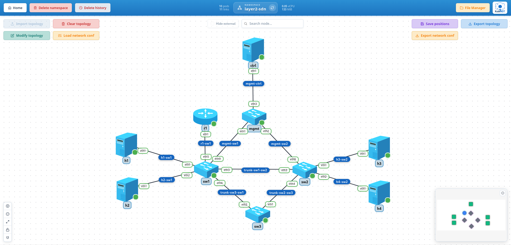

# 10-test-layer2-sdn

One site at layer 2: three switches in a triangle with two VLANs across their trunks, spanning tree breaking the loop, and the two ways to route between the VLANs, a router on a stick and an SVI on a layer 3 switch. A management network with an SDN controller is already in the topology for the second part of this example, where the two Open vSwitch switches are handed to the controller.

- VLANs on three switches of two kinds, Open vSwitch and a Linux bridge, with access ports for the hosts and 802.1Q trunks between the switches
- Classic spanning tree across both kinds, a root chosen by priority and the port it blocks read from the State tab
- Inter-VLAN routing twice: FRR subinterfaces on one trunk (router on a stick), then VLAN interfaces on the Linux bridge itself (an SVI), with the hosts' gateway moved from one to the other

## Topology Overview



Nodes deployed:

| Node | Driver | Image | Role |
| --- | --- | --- | --- |
| `h1`, `h3` | `HostDriver` | `alpine:3.24.2` | Hosts in VLAN 10, one behind each OVS switch |
| `h2`, `h4` | `HostDriver` | `alpine:3.24.2` | Hosts in VLAN 20, one behind each OVS switch |
| `sw1`, `sw2` | `OpenVSwitchDriver` | `ghcr.io/emigcm98/kubendt-ovs:3.7.1` | Access switches; `sw1` is the spanning tree root |
| `sw3` | `LinuxSwitchDriver` | `ubuntu:26.04` | A Linux bridge closing the triangle, the layer 3 switch of the SVI step |
| `r1` | `FRRRouterDriver` | `quay.io/frrouting/frr:10.7.1` | The router on a stick, one trunk into `sw1` |
| `mgmt` | `LinuxSwitchDriver` | `ubuntu:26.04` | The management switch, for the second part |
| `ctrl` | `FaucetControllerDriver` | `faucet/faucet:1.10.12` | The SDN controller, idle in this part |

VLANs and addresses:

| VLAN | Subnet | Hosts | Router on a stick | SVI |
| --- | --- | --- | --- | --- |
| 10 | `10.0.10.0/24` | `h1` (`.11`), `h3` (`.13`) | `r1 eth1.10` (`.1`) | `sw3 br0.10` (`.254`) |
| 20 | `10.0.20.0/24` | `h2` (`.12`), `h4` (`.14`) | `r1 eth1.20` (`.1`) | `sw3 br0.20` (`.254`) |

Links:

| Link | Ends | Carries |
| --- | --- | --- |
| `h1-sw1`, `h2-sw1` | `h1 eth1`, `h2 eth1` to `sw1 eth1`, `eth2` | Access, VLAN 10 and 20 |
| `h3-sw2`, `h4-sw2` | `h3 eth1`, `h4 eth1` to `sw2 eth1`, `eth2` | Access, VLAN 10 and 20 |
| `trunk-sw1-sw2` | `sw1 eth3` to `sw2 eth3` | Trunk, VLANs 10 and 20 |
| `trunk-sw2-sw3` | `sw2 eth4` to `sw3 eth1` | Trunk, VLANs 10 and 20; the side spanning tree blocks |
| `trunk-sw3-sw1` | `sw3 eth2` to `sw1 eth4` | Trunk, VLANs 10 and 20 |
| `r1-sw1` | `r1 eth1` to `sw1 eth5` | Trunk, the router on a stick |
| `mgmt-sw1`, `mgmt-sw2`, `mgmt-ctrl` | `sw1 eth9` (`10.0.100.11`), `sw2 eth9` (`10.0.100.12`), `ctrl eth1` (`10.0.100.1`) to `mgmt` | The management network, outside the bridges |

The three switches form a loop: `sw1` to `sw2`, `sw2` to `sw3`, `sw3` to `sw1`. Spanning tree runs on all three with `sw1` as root (priority 4096) and `sw2` next (8192), and the trunk costs set by hand (10 on every trunk port, 100 on `sw3`'s toward `sw2`), so the port `sw3` has toward `sw2` is the one left blocking whatever the pods' placement, and the hosts of VLAN 10 reach each other over `sw1-sw2` directly.

## Files In This Folder

- `topology-network-test-layer2-sdn.json`: the ten nodes and eleven links, the management network included
- `network_conf_switches.json`: the bridges of the three switches and the management switch, spanning tree on the triangle with the priorities
- `network_conf_vlans.json`: access ports for the hosts, the trunks between the switches and toward the router
- `network_conf_router.json`: the two subinterfaces of `r1` and the hosts' default route toward them
- `network_conf_svi.json`: the two VLAN interfaces on `sw3`'s bridge and the hosts' default route moved to them

Apply them in that order. After the first two the hosts of a VLAN see each other and nothing of the other VLAN; the third routes between the VLANs through `r1`; the fourth does the same through `sw3` instead.

## Notable Characteristics

- Spanning tree runs in its classic flavour on the three switches (`stp_enable` with `mode: stp`), since the Linux bridge speaks 802.1D only and Open vSwitch then meets it on the same path costs. On OVS alone `rstp` is the default and converges in a second instead of thirty.
- The root is chosen, not left to the lowest MAC: `stp_set_bridge_priority` 4096 on `sw1` and 8192 on `sw2` fixes which port blocks, so the State tab reads the same on every deploy. The path costs are set too (`stp_set_port`): the kernel and OVS take them from the link speed, 2 on a veth that reports 10 Gbit/s and 100 on a VXLAN device that reports none, which would move the blocked port with the placement of the pods.
- `sw3` is a plain `LinuxSwitchDriver`, like `mgmt`: the Linux switch carries the layer 3 and subinterface capabilities, so giving its bridge VLAN interfaces with addresses makes it a layer 3 switch without changing the driver.
- VLAN filtering on the Linux bridge comes with its first rule: `vlan_set_trunk` on `sw3 eth1` turns `vlan_filtering` on, and the bridge device itself is a port like the others, which is what the SVI step uses: `vlan_set_trunk` on `br0` lets the tagged frames of 10 and 20 reach the bridge's own interfaces `br0.10` and `br0.20`.
- The hosts keep one default route; the router and the SVI steps each `set_default_route` to their gateway, so the second replaces the first and a trace shows which box routes.
- The management network is ordinary links with addresses on the switch pods' `eth9`, left out of the bridges. The controller does nothing yet.

## Step-By-Step (UI)

### 1. Create namespace

Create a namespace (e.g. `layer2-sdn` or any name you prefer).

### 2. Import topology

- Go to the namespace graph view.
- Click **Import topology**.
- Select `topology-network-test-layer2-sdn.json`.
- Wait until the ten nodes are running (about half a minute).

### 3. Bridges and spanning tree

- Click **Load network conf** and select `network_conf_switches.json`.
- Wait half a minute, the listening and learning states of classic STP.
- Open the panel of `sw3`, tab **State**, section **Spanning tree ports**: `eth2` is the root port and `eth1` is `blocking`. On `sw1`, **Spanning tree bridges** shows it as root.

### 4. VLANs

- Load `network_conf_vlans.json`.
- Panel of `sw1`, **State**, **VLAN ports**: `eth1` access 10, `eth2` access 20, `eth3` to `eth5` trunks of 10 and 20.
- From `h1` (VLAN 10), reach `h3` behind the other switch, and not `h2` on the same switch:

  ```bash
  ping -c 3 10.0.10.13
  ping -c 3 10.0.20.12
  ```

- Capture on `sw1 eth3` (the trunk) from the link's menu while `h1` pings `h3`: the frames carry an 802.1Q tag with VLAN 10. On `sw1 eth1`, the access port, they carry none.
- **Bridge FDB** on `sw1` lists each host's MAC with its VLAN, `h3`'s and `h4`'s on the trunk `eth3`.

### 5. Router on a stick

- Load `network_conf_router.json`.
- Panel of `r1`, tab **Interfaces**: `eth1.10` and `eth1.20` with their addresses.
- From `h1`, reach `h2` in the other VLAN, and see the router on the way:

  ```bash
  ping -c 3 10.0.20.12
  traceroute -n 10.0.20.14
  ```

  The first hop is `10.0.10.1`, `r1`. The frames go up the trunk `sw1 eth5` tagged 10 and come back tagged 20.

### 6. An SVI instead

- Load `network_conf_svi.json`.
- Panel of `sw3`, **Interfaces**: `br0.10` and `br0.20`, the bridge's own VLAN interfaces. **VLAN ports** now lists `br0` itself as a trunk.
- The same trace from `h1` now shows `10.0.10.254`: `sw3` routes, `r1` is idle though still there.

## Experiments

- **The storm.** Take `sw3` out of spanning tree (`stp_disable` on `br0` through **Load network conf** or the panel), then from `h1` ask for an address nobody has, `ping -c 1 10.0.10.99`, and watch the counters of any trunk from the interface menu: that one ARP request goes round the triangle forever and the counters climb by tens of thousands a second (the hosts' own IPv6 multicast often starts it before you do). `stp_enable` again and it stops once the ports are back in listening. A few seconds are enough, the loop runs at the speed of the links.
- **Failover.** Disable `sw1 eth4` (the `sw3-sw1` trunk) from the interface menu: `sw3`'s blocked port toward `sw2` takes over after the forward delay, and `h1` still reaches `h2` through the SVI, now over `sw2`. Enable it back and the tree returns to its first shape.
- **Restart a switch.** Restart `sw1` from its menu: its bridge, VLANs and spanning tree are replayed, the root comes back where it was, and the pings pass again some ten seconds after.

## Troubleshooting

- The hosts of a VLAN do not see each other right after the VLAN step: spanning tree is still in listening or learning on a port of the path, thirty seconds in classic STP. The State tab of the switch shows the port's state.
- Both VLANs see each other after the VLAN step: a trunk is missing a VLAN or an access port got the wrong tag; **VLAN ports** on each switch shows what each port carries.
- `traceroute` from a host stops at the first hop: the default route points at a gateway of the other step, or `r1` has no subinterface for that VLAN; `ip route` on the host and **Interfaces** on the router tell which.
- `br0.10` on `sw3` gets no traffic: `br0` itself is not a trunk of VLAN 10, the `vlan_set_trunk` on the bridge device in `network_conf_svi.json` is what lets the tagged frames reach it.

> Last reviewed: 7 Nov 2026
