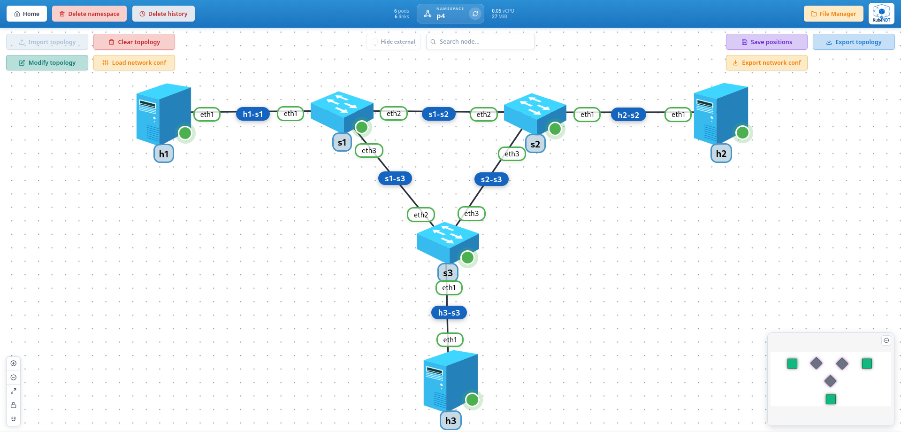

# 11-test-p4

Three P4 switches in a triangle, the topology of the p4lang tutorials, with a host behind each. The switches are BMv2's `simple_switch` on the `kubendt-p4` image and run the tutorials' `basic.p4`: no learning, no routing protocol, every packet goes where a table entry says, and the entries are pushed from KubeNDT. Then the second part on the same deploy: one switch swaps its program live for `ecmp.p4`, where a destination maps to a group of next hops picked by a hash of the flow, and parallel flows spread over its two uplinks.

- `basic.p4` on three switches, the entries from files as the tutorials' `sX-runtime.json`, read back from the State tab and the inspector
- The hosts as the tutorials' Mininet sets them, a fixed MAC, a gateway nobody owns and its MAC as a permanent neighbor, since the program drops ARP
- A capture with the destination MAC rewritten and the TTL taken by each switch, and a path changed by replacing one entry, seen in the interface counters
- A switch restart, its ports, program and entries replayed, and the hosts' MACs and neighbors put back on their recreated ends
- A program swapped live on one switch, its tables empty until the entries follow, and equal-cost multipath measured with iperf

## Topology Overview



Nodes deployed:

| Node | Driver | Image | Role |
| --- | --- | --- | --- |
| `h1`, `h2`, `h3` | `HostDriver` | `alpine:3.24.2` | One host behind each switch |
| `s1`, `s2`, `s3` | `P4SwitchDriver` | `ghcr.io/emigcm98/kubendt-p4:1.15.8` | BMv2 `simple_switch`, `basic.p4` on all three, `ecmp.p4` on `s1` in the second part |

Addresses, the tutorials' plan:

| Host | Address | MAC | Gateway (address, MAC) |
| --- | --- | --- | --- |
| `h1` | `10.0.1.1/24` | `08:00:00:00:01:11` | `10.0.1.10`, `08:00:00:00:01:00` |
| `h2` | `10.0.2.2/24` | `08:00:00:00:02:22` | `10.0.2.20`, `08:00:00:00:02:00` |
| `h3` | `10.0.3.3/24` | `08:00:00:00:03:33` | `10.0.3.30`, `08:00:00:00:03:00` |

Links:

| Link | Ends | BMv2 ports |
| --- | --- | --- |
| `h1-s1`, `h2-s2`, `h3-s3` | each host's `eth1` to its switch's `eth1` | port 1 of every switch |
| `s1-s2` | `s1 eth2` to `s2 eth2` | port 2 on both |
| `s1-s3` | `s1 eth3` to `s3 eth2` | port 3 of `s1`, port 2 of `s3` |
| `s2-s3` | `s2 eth3` to `s3 eth3` | port 3 on both |

The gateways do not exist: a host sends everything to its switch, which rewrites the destination MAC to the next hop's and the next switch does not look at it. The MAC a switch "has" (`08:00:00:00:0N:00`) is a convention of the entries, nothing carries it. Each switch's port number is its interface number, so an entry's output port reads from the topology.

## Files In This Folder

- `topology-network-test-p4.json`: the six nodes and six links
- `files/basic.p4`, `files/basic.json`, `files/basic.p4info.txtpb`: the tutorials' program, L3 forwarding by one longest-prefix table, and its compiled form for BMv2
- `files/ecmp.p4`, `files/ecmp.json`, `files/ecmp.p4info.txtpb`: the same program with a second table, `ecmp_nhop`, and an action that hashes the flow onto a group of next hops
- `network_conf_hosts.json`: a fixed MAC, the default route to the fake gateway and the gateway's MAC as a static neighbor, on each host
- `network_conf_switches.json`: the three interfaces of each switch as ports, `basic.json` loaded, `drop` as the default action
- `network_conf_entries.json`: the forwarding entries of the three switches, the tutorials' `s1-runtime.json` to `s3-runtime.json`
- `network_conf_reroute.json`: on `s1`, the entry for `h3` replaced so it leaves toward `s2`
- `network_conf_ecmp.json`: on `s1`, `ecmp.json` loaded and its entries, `h3` behind a group of two next hops

Upload the `files/` folder to the file manager first, deploy, then apply the configurations in that order. After the first three the hosts reach each other; the fourth bends one path; the fifth is the second part.

## Notable Characteristics

- The switch starts empty: `setup_bridge` gives it the pod's interfaces as ports, `load_program` the compiled program (a file of the namespace by name, read when the action runs), and the entries follow. Nothing of this lives in the image, so the same image runs any program.
- `basic.p4` has one table, `ipv4_lpm`, keyed by the destination address with longest-prefix match. Its `ipv4_forward` action takes the next hop's MAC and the output port, writes them into the frame and takes one from the TTL; `drop` is the default, so a destination without an entry goes nowhere, ARP included. That is why the hosts need their gateway's MAC as a static neighbor (`add_static_neighbor`) and a MAC the entries can name (`set_mac`), as the tutorials' Mininet does with `arp -s` and a fixed `mac`.
- The entries are actions like any other: `table_add` with the table, the action, the match key and the action's parameters as `simple_switch_CLI` takes them, kept in the history by table and key, so `table_delete` with the same key clears the add, and a restart replays them in order. `p4_entries` reads them back from the switch, with the handle BMv2 gave each.
- A program swap is `load_program` on a running switch: BMv2 swaps the new program in without dropping the ports, but its tables come up empty, so the entries must be added again. The action clears the old entries from the history, and `network_conf_ecmp.json` carries the new ones in the same request, under a second of outage in all.
- `ecmp.p4` adds `set_ecmp_group(group, count)` as a possible action of `ipv4_lpm`: it hashes source and destination address, protocol and ports (a CRC16, in v1model's `hash`) into a number below `count`, and a second table, `ecmp_nhop`, keyed by the group and that number, picks the next hop. Every packet of a flow hashes alike, so a flow never reorders; different flows spread.
- BMv2 reads and writes its ports through packet sockets, so it forwards whole frames and cannot send one larger than the port's MTU. The driver turns the segmentation and receive offloads off on its ports for that reason, and a port on a link to another worker, a VXLAN tunnel, reads through a veth pair of its own: the worker's NIC merges the TCP segments of a flow arriving through the tunnel into frames of several segments, and the veth, with its offloads off, has the kernel split them again before the switch sees them (`ip -d link` in the switch shows `eth2-tc` and `eth2-p4` next to such a port). A switch forwards a few hundred Mbit/s and some fifty thousand packets per second, software numbers, with two to three cores busy.
- The hosts' MACs are fixed by an action, not by Meshnet, which assigns a random one each time it creates an interface. A switch restart recreates the hosts' ends too, and the peer replay re-runs `set_mac` and `add_static_neighbor` on them, so the entries that name those MACs stay valid.

## Step-By-Step (UI)

### 1. Create namespace

Create a namespace (e.g. `p4` or any name you prefer).

### 2. Upload the programs

- Open **File Manager** and upload the six files of `files/` to the namespace, the `.p4` sources included so they can be read next to their compiled form.

### 3. Import topology

- Go to the namespace graph view.
- Click **Import topology**.
- Select `topology-network-test-p4.json`.
- Wait until the six nodes are running (the switches are ready once their CLI port answers).

### 4. Hosts

- Click **Load network conf** and select `network_conf_hosts.json`.
- Panel of `h1`, tab **State**, section **ARP and NDP**: `10.0.1.10` with `08:00:00:00:01:00` as `PERMANENT`. The **Links** tab shows `eth1` with its MAC, `08:00:00:00:01:11`.

### 5. Switches and their program

- Load `network_conf_switches.json`.
- Panel of `s1`, **State**: **P4 ports** lists `eth1` to `eth3` as ports 1 to 3, up; **P4 tables** lists `MyIngress.ipv4_lpm` with its match field, `ipv4.dstAddr (lpm, 32)`; **P4 table entries** is empty, every packet hits the default `drop`.
- From `h1`, `ping -c 2 10.0.2.2` fails.

### 6. The entries

- Load `network_conf_entries.json`.
- **P4 table entries** on `s1`: `10.0.1.1/32` out of port 1 toward `h1`'s MAC, `10.0.2.2/32` out of port 2, `10.0.3.3/32` out of port 3, each with its handle. The switch shows keys and parameters as it stores them, in hex (`0a000101/32`, `080000000111, 01`), and the default action of each table as one more row.
- From `h1`, reach the other two:

  ```bash
  ping -c 3 10.0.2.2
  ping -c 3 10.0.3.3
  ```

  The replies show `ttl=62`: two switches on the way, each took one.

- Capture on the link `s1-s3` from its menu while `h1` pings `h3`: the frames from `h1` carry `08:00:00:00:03:00` as destination, the MAC `s1`'s entry wrote, and a TTL of 63 already.
- **Throughput test** from `h1` to `10.0.3.3`: a few hundred Mbit/s through two software switches.

### 7. Bend a path

- Load `network_conf_reroute.json`: on `s1`, the entry for `10.0.3.3/32` is deleted and added again out of port 2. `h1`'s packets to `h3` now go to `s2`, which forwards them to `s3` by its own entry; `h3`'s replies still come straight back, `s3`'s entry for `h1` did not change.
- Open the counters of `s1 eth2` and `s1 eth3` from the interface menu while `h1` pings `h3`: `eth2` transmits, `eth3` only receives.

### 8. Restart a switch

- Restart `s2` from its menu: its ports, program and entries come back from the history, and **P4 table entries** reads the same three. The hosts' ends `s2` faced were recreated too; `h2`'s MAC and neighbor were put back by the peer replay, so `ping 10.0.2.2` from `h1` passes again a few seconds after.

### 9. ECMP on `s1`, live

- Load `network_conf_ecmp.json`: `s1` loads `ecmp.json` in place of `basic.json` (its ports stay, its tables come up empty) and gets its entries in the same request: `h1` and `h2` as before, and `10.0.3.3/32` to `set_ecmp_group` 1 with two members, port 3 straight to `s3` and port 2 through `s2`, in `ecmp_nhop`.
- **P4 tables** on `s1` now lists `ecmp_nhop` with its two match fields; **P4 table entries** the group's two next hops, keyed by group 1 and index 0 or 1. `s2` and `s3` still run `basic.p4`.
- From `h1`, `ping -c 3 10.0.3.3`: it passes, every echo of the same flow by the same uplink.
- Open the counters of `s1 eth2` and `s1 eth3`, then run the **Throughput test** from `h1` to `10.0.3.3` several times: each run is a new flow with a new source port, and over a few runs both counters climb. With iperf3 in the hosts' toolboxes, `iperf3 -c 10.0.3.3 -P 16` spreads sixteen flows at once.
- Restart `s1`: `ecmp.p4` and its entries are what the history replays, and the group is back.

## Experiments

- **Drop a host.** `table_delete` on `s1` with `10.0.2.2/32` through **Load network conf**: `h1` loses `h2` while `h3` goes on, and the State tab shows the entry gone. Add it back with the same `table_add` as in `network_conf_entries.json`.
- **A wrong MAC.** Add `h2`'s entry on `s2` with another MAC: the switch forwards, `h2`'s kernel drops the frame as not its own, and the ping fails though every counter climbs. The capture on `h2-s2` shows why.
- **Loop it.** Point `s1`'s entry for `h3` at port 2 and `s2`'s at port 2 too: each switch hands the packet back to the other until the TTL reaches zero, some thirty round trips, visible in the counters of `s1-s2`. Nothing else protects a P4 network from itself.
- **Three ways.** Make `h3` a group of three on `s1` (`set_ecmp_group 1 3` and a third `ecmp_nhop` entry, `1 2`, out of port 1 toward `h1` itself): the flows that hash to it go back to `h1` and die, a third of them. The counters of `s1 eth1` show the share.
- **The program that answers ARP.** `basic.p4` drops ARP, so the hosts carry static neighbors. A program that floods ARP to every port (a multicast group, `mc_mgrp_create` and `mc_node_create` in BMv2's CLI) and forwards IPv4 by table would let the hosts resolve a real neighbor, but a triangle floods back onto itself: the groups would have to form a tree, one port left out somewhere. KubeNDT has no action for the groups yet; the CLI of the switch (`simple_switch_CLI` in the pod's terminal) takes them by hand.

## Troubleshooting

- A ping fails right after the entries: a `table_add` was refused, the configure result names the entry and the CLI's reason (an action or table that is not in the program, a key in the wrong form). **P4 table entries** shows what the switch holds.
- A ping fails and the entries are right: the host's MAC is not the one the entry names (the **Links** tab of the host), or the gateway's neighbor is missing (**ARP and NDP** on the host, it must read `PERMANENT`); both are in `network_conf_hosts.json`.
- Everything stops after `network_conf_ecmp.json`: the program swap emptied `s1`'s tables and an entry of the new set was refused; load the file again once fixed, or `network_conf_switches.json` and `network_conf_entries.json` to go back to `basic.p4` on `s1`.
- The flows do not spread: one flow is one path by design; several runs of the throughput test, or `iperf3 -P`, are needed to see both uplinks move.
- A switch pod never becomes ready: the image could not be pulled (`ghcr.io/emigcm98/kubendt-p4`, public), or its CLI port is not answering; the pod's logs show `simple_switch` starting.

> Last reviewed: 11 Nov 2026
