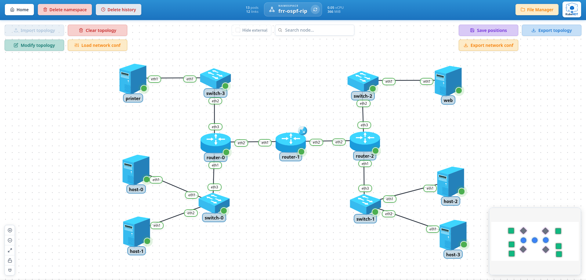

# 2-test-frr-ospf-rip

FRR routing end-to-end scenario with two interior gateway protocols side by side, to validate the routing workflows of KubeNDT:

- Topology import and deployment
- Driver-based network configuration
- OSPF on one side of the network, RIP on the other, redistributed both ways by the router in the middle
- FRR daemon configuration from the UI
- L3 connectivity across three routers and four subnets

## Topology Overview



Nodes deployed:

| Node | Driver | Image | Replicas | Role |
| --- | --- | --- | --- | --- |
| `host` | `BasicHostDriver` | `alpine:3.24.2` | 4 | Alpine hosts, two on the OSPF side and two on the RIP side |
| `printer` | `BasicHostDriver` | `alpine:3.24.2` | 1 | A printer on its own LAN on the OSPF side |
| `web` | `BasicHostDriver` | `nginxdemos/hello:0.4` | 1 | Web server on its own LAN on the RIP side |
| `router` | `FRRRouterDriver` | `quay.io/frrouting/frr:10.7.1` | 3 | One node, three roles given by the configuration: `router-0` is the OSPF router (two LANs), `router-1` the border router (OSPF on one side, RIP on the other, redistribution both ways, SNAT on `eth0` for internet access), `router-2` the RIP router (two LANs) |
| `switch` | `LinuxSwitchDriver` | `ubuntu:26.04` | 4 | Linux bridge switches, one per LAN |

Nodes without a `driver` in the topology JSON get the default of their type: `BasicHostDriver` for hosts and `LinuxSwitchDriver` for switches.

Network segments:

| Segment | Subnet | Purpose |
| --- | --- | --- |
| LAN 1, OSPF side | `192.168.1.0/24` | `host-0` and `host-1` behind `switch-0`; `router-0 eth1` (`.1`) is the gateway |
| LAN 4, OSPF side | `192.168.4.0/24` | `printer-0` (`.10`) behind `switch-3`; `router-0 eth3` (`.1`) is the gateway |
| OSPF transit | `10.0.0.0/30` | `router-0 eth2` (`.1`) and `router-1 eth1` (`.2`), OSPF area 0 |
| RIP transit | `10.0.1.0/30` | `router-1 eth2` (`.1`) and `router-2 eth2` (`.2`), RIPv2 |
| LAN 2, RIP side | `192.168.2.0/24` | `host-2` and `host-3` behind `switch-1`; `router-2 eth1` (`.1`) is the gateway |
| LAN 3, RIP side | `192.168.3.0/24` | `web-0` (`.10`) behind `switch-2`; `router-2 eth3` (`.1`) is the gateway |

## Files In This Folder

- `topology-network-test-frr-ospf-rip.json`: network inventory and links
- `network_conf_ospf.json`: the OSPF side: its hosts, switches and addresses, `router-0` with OSPF, and the OSPF face of `router-1` plus its SNAT
- `network_conf_rip.json`: the RIP side: its hosts, switches and addresses, `router-2` with RIP, and the RIP face of `router-1`
- `network_conf_redistribute.json`: the two lines on `router-1` that put each protocol into the other, the step that joins the two sides

## Notable Characteristics

- The three routers are replicas of one node, `router`, so they share image, driver and startup command; what makes `router-0` the OSPF router, `router-1` the border router and `router-2` the RIP router is the configuration applied to each pod, as with any StatefulSet replica in KubeNDT. They run `quay.io/frrouting/frr:10.7.1` through the image's own init (`watchfrr` under `tini`). The startup command installs `iptables`, which `enable_snat` needs and the image does not ship, enables `ospfd`, `ripd` and `ripngd` in `/etc/frr/daemons` (FRR starts a daemon only when its line says so, and KubeNDT refuses an action whose daemon is off with a message that says what to enable), and creates the empty `frr.conf` and `vtysh.conf` the image expects.
- The two OSPF routers set their router ID explicitly (`ospf_set_router_id`, `10.0.0.1` and `10.0.0.2`); without it FRR picks the pod's `eth0` address, which belongs to the cluster, not to the lab.
- `router-0` speaks only OSPF and `router-2` only RIP; `router-1` speaks both and is where the two meet: `ospf_redistribute rip` puts the RIP side's LANs into OSPF (`router-0` sees them as `O E2` routes) and `rip_redistribute ospf` puts the OSPF side's LANs into RIP (`router-2` sees them as `R` routes). Either direction alone leaves one side blind, see the experiments below.
- `router-1` enables `SNAT` on `eth0`, acting as the upstream edge for both sides; `router-0` and `router-2` point their default route at it with `set_default_route`, which on FRR routers goes through staticd and shows in the running-config.
- Both protocols stay quiet on the LANs, each in its own way: RIP marks the LAN interfaces of `router-2` passive one by one (`rip_passive_interface`), OSPF declares every interface passive by default (`ospf_passive_default`) and activates only the transit link (`ospf_no_passive` on `router-0 eth2` and `router-1 eth1`). Nothing would break without it here, the LANs have no other router, but hosts should not see Hellos and a stray router on a LAN should not form an adjacency.
- `switch-*` nodes are Linux bridges set up with `setup_bridge`.
- The configuration comes in three files: the OSPF side, the RIP side and the redistribution. After the first two each side routes within itself and knows nothing of the other; the third, two actions on `router-1`, is what joins them. Apply them in that order to see each step, or all three at once.
- The two side files replace the `eth1` address of every `host-*` (`replace_ip`) before setting its default route, so the addresses used in the connectivity checks below are the ones they assign, not the ones in the topology file.

## Step-By-Step (UI)

### 1. Create namespace

Create a namespace (e.g. `frr-ospf-rip` or any name you prefer).

### 2. Import topology

- Go to the namespace graph view.
- Click **Import topology**.
- Select `topology-network-test-frr-ospf-rip.json`.
- Wait until all nodes are running and visible.

### 3. Apply network configuration

- Click **Load network conf** and select `network_conf_ospf.json`: addresses, bridges and OSPF on `router-0` and the OSPF face of `router-1`, plus its SNAT.
- Load `network_conf_rip.json` the same way: addresses, bridges and RIP on `router-2` and the RIP face of `router-1`. At this point `host-0` reaches the printer and `host-2` reaches the web, but neither side reaches the other: try it.
- Load `network_conf_redistribute.json`: the two redistribution lines on `router-1`. Within an OSPF SPF run and a RIP update (up to 30 seconds) both sides see each other.

### 4. Validate the two protocols and the redistribution

- Open a vtysh console on `router-0` (the OSPF router) by selecting the node and clicking the blue shell button, or open a shell and run:

  ```bash
  vtysh -c "show ip ospf neighbor"
  ```

  Expected: `router-1` (router ID `10.0.0.2`) in `Full` state.

- On `router-0`, check the routes:

  ```bash
  vtysh -c "show ip route"
  ```

  Expected: `192.168.2.0/24` and `192.168.3.0/24` as `O>* ... [110/20] via 10.0.0.2`, the RIP side's LANs redistributed from RIP. FRR does not tag the route type in this table, the fixed metric of 20 is the hint; the type shows in the OSPF view:

  ```bash
  vtysh -c "show ip ospf route"
  ```

  Expected: both prefixes under "OSPF external routing table" as `N E2`, and `router-1` (router ID `10.0.0.2`) listed as `ASBR` in the router routing table.

- On `router-2`:

  ```bash
  vtysh -c "show ip rip"
  ```

  Expected: `192.168.1.0/24` and `192.168.4.0/24` as `R(n)` routes via `10.0.1.1` within the first update (RIP sends one every 30 seconds), the OSPF side's LANs redistributed from OSPF.

- On `router-1`, both tables and the redistribution lines:

  ```bash
  vtysh -c "show ip route"
  vtysh -c "show running-config" | grep redistribute
  ```

### 5. Validate end-to-end connectivity

- From `host-0` to `host-1` (same subnet):

  ```bash
  ping -c 3 192.168.1.52
  ```

- From `host-0` to the printer (same side, routed by `router-0`):

  ```bash
  ping -c 3 192.168.4.10
  ```

- From `host-0` to `host-2` (across the three routers, from the OSPF side to the RIP side):

  ```bash
  ping -c 3 192.168.2.51
  ```

- From `host-2` to the printer (the other way round):

  ```bash
  ping -c 3 192.168.4.10
  ```

- From `host-1`, verify application reachability:

  ```bash
  wget -qO- http://192.168.3.10
  ```

  Expected output from the `nginxdemos/hello` page.

- Trace the path from the **Tools** menu of `host-0` to `192.168.3.10`: three hops, `router-0`, `router-1` and `router-2`.

## Experiments

- **One-way redistribution.** Apply `ospf_remove_redistribute` with `redistribute: "rip"` on `router-1` (or load `network_conf_redistribute.json` with only its `rip_redistribute` line): the OSPF side loses the RIP side's routes while the RIP side keeps the OSPF ones, so `host-0` cannot reach `192.168.2.51`, and `host-2` pinging `192.168.4.10` fails too because the reply has no route back, which is the point. Put it back with `ospf_redistribute`, or give `router-0` a default route instead and compare.
- **RIP timers.** `rip_set_timers` on `router-2` and `router-1` with `timers: {"update": 5, "timeout": 30, "garbage": 20}` makes RIP converge in seconds instead of minutes after a link goes down; `rip_remove_timers` restores the defaults.
- **RIPng.** Every RIP action takes `family: "6"`, and a network's family comes from its prefix, so a v6 prefix on the RIP side's links turns the same configuration into RIPng (`ripngd` is already enabled). Example 7 shows dual stack links.

## Troubleshooting

- If `show ip ospf neighbor` on `router-0` is empty, verify both ends have the OSPF actions applied and that the `10.0.0.0/30` link is up.
- If `show ip rip` on `router-2` shows no routes, verify `router-1` has `rip_add_network 10.0.1.0/30` (in `network_conf_rip.json`) and `rip_redistribute ospf` (in `network_conf_redistribute.json`), and wait one update (30 seconds).
- If an OSPF or RIP action fails with "ospfd is not running" or "ripd is not running", the router was started without that daemon: the startup command in the topology enables it, see the troubleshooting guide.
- If inter-subnet ping fails, check which side is missing routes with `vtysh -c "show ip route"` on `router-0` and `router-2`; each needs the other side's LANs, which only the two lines of `network_conf_redistribute.json` on `router-1` provide.
- If same-subnet ping fails, verify `br0` exists on the corresponding `switch-*` node and includes all expected interfaces.
- If outbound internet access is required from downstream networks, verify `router-1` has `SNAT` enabled on `eth0` and that the other two routers keep their default route towards it.
