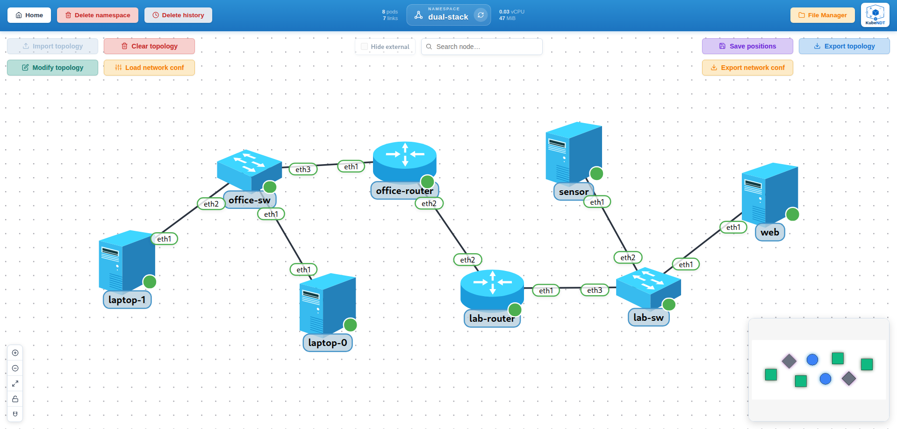

# 7-test-dual-stack

IPv6 end-to-end scenario, dual stack where it makes sense and IPv6 only where a real network would be, to validate the IPv6 workflows of KubeNDT:

- Links that carry several addresses, one per family, declared as arrays in the topology JSON
- IPv4 routed by OSPFv2 and IPv6 by OSPFv3, both set from the same `network_conf.json`
- An IPv6-only host next to dual stack ones on the same L2 segment
- Traceroute, mtr and iperf3 toward IPv6 targets from the dashboard
- NAT66 on the lab router: the lab masqueraded behind its transit address and a port forwarded to the web server over IPv6
- A router restart that brings back its addresses and its IPv6 routes

## Topology Overview



Nodes deployed:

| Node | Driver | Image | Replicas | Role |
| --- | --- | --- | --- | --- |
| `laptop` | `HostDriver` | `alpine:3.24.2` | 2 | Dual stack hosts on the office LAN |
| `sensor` | `HostDriver` | `alpine:3.24.2` | 1 | IPv6-only host on the lab LAN |
| `web` | `HostDriver` | `nginx:1.31.6-alpine` | 1 | Dual stack web server on the lab LAN, serves the mounted `index.html` on both families |
| `office-router` | `FRRRouterDriver` | `quay.io/frrouting/frr:10.7.1` | 1 | Office gateway: OSPFv2 for IPv4 and OSPFv3 for IPv6 |
| `lab-router` | `FRRRouterDriver` | `quay.io/frrouting/frr:10.7.1` | 1 | Lab gateway: OSPFv2 for IPv4 and OSPFv3 for IPv6 |
| `office-sw`, `lab-sw` | `LinuxSwitchDriver` | `alpine:3.24.2` | 1 each | Linux bridge switches, one per LAN |

Nodes without a `driver` in the topology JSON get the default of their type: `HostDriver` for hosts and `LinuxSwitchDriver` for switches.

Network segments:

| Segment | IPv4 | IPv6 | Purpose |
| --- | --- | --- | --- |
| Office LAN | `192.168.10.0/24` | `fd00:10::/64` | `laptop-0` (`.11`, `::11`) and `laptop-1` (`.12`, `::12`) behind `office-sw`; `office-router eth1` (`.1`, `::1`) is the gateway for both families |
| Transit | `10.0.0.0/30` | `fd00:1::/64` | Point-to-point link between `office-router eth2` (`.1`, `::1`) and `lab-router eth2` (`.2`, `::2`) |
| Lab LAN | `192.168.20.0/24` | `fd00:20::/64` | `web-0` (`.10`, `::10`) and `sensor-0` (`::50`, IPv6 only) behind `lab-sw`; `lab-router eth1` (`.1`, `::1`) is the gateway |

## Files In This Folder

- `topology-network-test-dual-stack.json`: network inventory and links, with `localIp` and `peerIp` as arrays where an end carries both families
- `network_conf.json`: post-deploy actions (bridges, default routes of both families on the hosts, OSPFv2 and OSPFv3 on the routers)
- `network_conf_nat66.json`: NAT66 on `lab-router`, SNAT on its transit interface and a port forward to `web`
- `files/web/index.html`: the page `web` serves, mounted into the nginx image

## Notable Characteristics

- An end of a link takes one address or an array: `["192.168.10.11/24", "fd00:10::11/64"]`. The first one is wired with the link by Meshnet; the rest are set by the platform right after wiring and again after every recreation, so a restart brings them back. `GET /network/get-network` and the topology export echo the array, and the link, node and interface panels list every address of an interface.
- `sensor` has an IPv6 address only. The two ends of a link must share at least one family, so its link to `lab-sw` carries no IPv4 at all, while `web` next to it is dual stack.
- Routers forward both families out of the box: `net.ipv4.ip_forward` and `net.ipv6.conf.all.forwarding` are set on every router and switch pod. The cluster's kubelet must allow both sysctls, see the cluster guide.
- IPv4 is routed by OSPFv2 between the two routers (`ospf_add_network`, network statements) and IPv6 by OSPFv3 (`ospf6_add_interface`, an interface joins an area, as the protocol is configured), each in its own FRR daemon (`ospfd` and `ospf6d`); the routers declare no startup command, the `FRRRouterDriver` enables the daemons behind its capabilities and creates the files vtysh expects when a node sets none, as the stock FRR image enables nothing. The LAN interfaces are passive in OSPFv3 (`ospf6_passive_interface`); the two processes share nothing but the router ID the configuration gives them.
- A host's default routes are two `set_default_route` actions with a gateway of each family; `remove_default_route` takes `family` (`4` or `6`) to drop one of them.
- Every link is set to the platform MTU (1450 by default), which is above the 1280 bytes IPv6 needs. A link that declares its own `mtu` below 1280 with an IPv6 address on it is refused.
- The web server listens on both families, so `wget http://192.168.20.10` and `wget http://[fd00:20::10]` return the same page.

## Step-By-Step (UI)

### 1. Create namespace

Create a namespace (e.g. `dual-stack` or any name you prefer).

### 2. Upload the web page

- Open the **File Manager** of the namespace.
- Upload `files/web/index.html` to `web/index.html`, the path the topology mounts.

### 3. Import topology

- Go to the namespace graph view.
- Click **Import topology**.
- Select `topology-network-test-dual-stack.json`.
- Wait until all nodes are running and visible. Open the link panel of `laptop-0`: its end lists both addresses, the IPv4 and the IPv6.

### 4. Apply network configuration

- Click **Load network conf**.
- Select `network_conf.json`.
- Confirm successful actions in the result dialog. This sets up the bridges, the default routes of both families on the hosts, OSPFv2 and OSPFv3 on the routers in one step.

### 5. Validate routing on the routers

- Open a shell on `office-router-0` and check both OSPF processes and the IPv6 table:

  ```bash
  vtysh -c "show ip ospf neighbor"
  vtysh -c "show ipv6 ospf6 neighbor"
  vtysh -c "show ipv6 route"
  vtysh -c "show ipv6 route"
  ```

  Expected: `lab-router` in `Full` state in both outputs (`show ipv6 ospf6 neighbor` lists it by router ID `10.0.0.2`), and `fd00:20::/64` as an OSPFv3 route (`O`) via the link-local address of `lab-router` on `eth2`, which is how OSPFv3 next hops look.

### 6. Validate end-to-end connectivity

- From `laptop-0` to `web-0` over IPv4, through OSPF:

  ```bash
  ping -c 3 192.168.20.10
  ```

- From `laptop-0` to `web-0` and to `sensor-0` over IPv6, through OSPFv3:

  ```bash
  ping -c 3 fd00:20::10
  ping -c 3 fd00:20::50
  ```

- From `sensor-0`, which has no IPv4, fetch the page over IPv6:

  ```bash
  wget -qO- http://[fd00:20::10]
  ```

  Expected: the mounted page, "Hello from the dual stack web server".

### 7. Trace and measure over IPv6

- Right-click `laptop-0`, open **Tools** and **Traceroute from here**. Pick `sensor` as the node: the panel lists its addresses, here only `fd00:20::50`. Run it and watch the packet cross `office-router`, `lab-router` and reach `sensor`. Over IPv6 the ICMP method sends UDP probes (BusyBox traceroute only matches those in the routers' Time Exceeded replies), the **Metrics** mode runs mtr over IPv6 with real ICMP, and TCP traceroute stays IPv4, the tool behind it has no IPv6.
- Right-click `laptop-0` again, open **Throughput test from here** and pick `web`: choose its IPv6 address from the list and run. The platform starts the iperf3 server on `web-0` itself.

### 8. NAT66 on the lab router

- Apply `network_conf_nat66.json` to `lab-router-0`: `enable_snat` on `eth2` with `family: "6"` masquerades everything the lab sends toward the office behind `fd00:1::2`, and `enable_dnat` on `eth2` forwards TCP 8080 to `web` on port 80; the family of a port forward comes from its internal address.
- From `laptop-0`, `wget -qO- http://[fd00:1::2]:8080` returns the page: the forward hands the request to `web`.
- Ping `fd00:10::11` from `sensor-0` and capture on `laptop-0 eth1` meanwhile: the echo requests arrive from `fd00:1::2`, not from the sensor. Without the SNAT they carry `fd00:20::50`.
- The rules live in `ip6tables` inside the router's network namespace, run from the pod's toolbox since the FRR image ships no iptables; the node's history keeps both actions and replays them when the pod is recreated.

### 9. Restart a router

- Right-click `lab-router-0` and choose **Restart pod**. The pod comes back with both addresses on every link end (the first from the link, the second from the platform) and its persisted operations replayed, OSPFv3 included: both adjacencies come back. The NAT66 rules come back with them: the `wget` through the forward works again.
- Repeat the IPv6 ping from `laptop-0` to `sensor-0`.

## Troubleshooting

- If `show ip ospf neighbor` is empty, verify both routers have the OSPF actions applied and that the `10.0.0.0/30` link is up.
- If the IPv6 pings fail but the IPv4 ones work, check the OSPFv3 adjacency on both routers (`vtysh -c "show ipv6 ospf6 neighbor"`) and the IPv6 default route on the host (`ip -6 route show default`). An OSPFv3 action failing with "ospf6d is not running" means the router was started without that daemon.
- If an end shows only its first address, look at the `warnings` of the deploy or restart response: the platform reports an address it could not set as `link_address_not_set`.
- If a router pod stays in `SysctlForbidden`, the kubelet does not allow `net.ipv6.conf.all.forwarding`; the cluster guide has the `allowedUnsafeSysctls` list.
- If `wget http://[fd00:20::10]` fails while the ping works, make sure the mounted page is in place and that `web-0` has its IPv6 default route; the nginx image listens on `[::]:80` by default.
