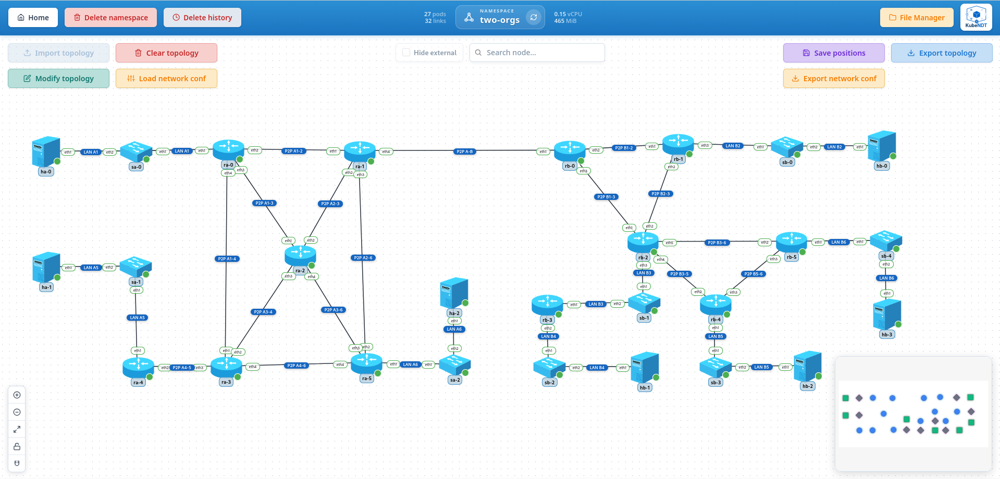

# 8-test-two-orgs-rip-ospf

Two organizations, each with its own interior routing, joined by a border router that redistributes between them: organization A runs RIPv2 over a mesh of six routers, organization B runs OSPFv2 in four areas, and the example walks through the classic exercises on such a network (routing tables, DR and BDR, stub and totally stubby areas, summarization, redistribution, LSA types). It exercises:

- The whole RIP and OSPF surface of KubeNDT on FRR: networks, passive interfaces, point-to-point links, priority, cost, area types, area ranges, authentication, redistribution
- A 27 pod, 32 link topology deployed and configured from four files
- Routing tables, neighbours and traceroutes read from the routers' consoles, link failures and captures from the UI

## Topology Overview



Nodes deployed:

| Node | Driver | Image | Replicas | Role |
| --- | --- | --- | --- | --- |
| `ra` | `FRRRouterDriver` | `quay.io/frrouting/frr:10.7.1` | 6 | Organization A routers, RIPv2. `ra-0` to `ra-5` are RA1 to RA6 in the diagram; `ra-1` (RA2) is A's border router |
| `sa` | `OpenVSwitchDriver` | `globocom/openvswitch:latest` | 3 | Organization A switches, one per LAN (A1, A5, A6) |
| `ha` | `HostDriver` | `alpine:3.24.2` | 3 | Organization A hosts, one per LAN |
| `rb` | `FRRRouterDriver` | `quay.io/frrouting/frr:10.7.1` | 6 | Organization B routers, OSPFv2. `rb-0` to `rb-5` are RB1 to RB6; `rb-0` (RB1) is B's border router, `rb-1` (RB2) and `rb-2` (RB3) are the ABRs |
| `sb` | `OpenVSwitchDriver` | `globocom/openvswitch:latest` | 5 | Organization B switches, one per LAN (B2, B3, B4, B5, B6) |
| `hb` | `HostDriver` | `alpine:3.24.2` | 4 | Organization B hosts, on LANs B2, B4, B5 and B6 |

The replicas of a node share image and driver; the configuration files give each one its role. The diagram names the routers from 1 and Kubernetes numbers replicas from 0, so `ra-3` is RA4 and `rb-2` is RB3; the tables below name both.

Organization A, `172.22.48.0/22`, RIPv2:

| Segment | Subnet | Ends |
| --- | --- | --- |
| LAN A1 (400 hosts) | `172.22.48.0/23` | `ra-0 eth1` (`.48.1`), `ha-0` (`.48.10`) behind `sa-0` |
| LAN A5 (110 hosts) | `172.22.50.0/25` | `ra-4 eth1` (`.50.1`), `ha-1` (`.50.10`) behind `sa-1` |
| LAN A6 (25 hosts) | `172.22.50.128/27` | `ra-5 eth1` (`.50.129`), `ha-2` (`.50.138`) behind `sa-2` |
| RA1-RA2 | `172.22.50.160/30` | `ra-0 eth2` (`.161`), `ra-1 eth1` (`.162`) |
| RA1-RA3 | `172.22.50.164/30` | `ra-0 eth3` (`.165`), `ra-2 eth1` (`.166`) |
| RA1-RA4 | `172.22.50.168/30` | `ra-0 eth4` (`.169`), `ra-3 eth1` (`.170`) |
| RA2-RA3 | `172.22.50.172/30` | `ra-1 eth2` (`.173`), `ra-2 eth2` (`.174`) |
| RA2-RA6 | `172.22.50.176/30` | `ra-1 eth3` (`.177`), `ra-5 eth2` (`.178`) |
| RA3-RA4 | `172.22.50.180/30` | `ra-2 eth3` (`.181`), `ra-3 eth2` (`.182`) |
| RA3-RA6 | `172.22.50.184/30` | `ra-2 eth4` (`.185`), `ra-5 eth3` (`.186`) |
| RA4-RA5 | `172.22.50.188/30` | `ra-3 eth3` (`.189`), `ra-4 eth2` (`.190`) |
| RA4-RA6 | `172.22.50.192/30` | `ra-3 eth4` (`.193`), `ra-5 eth4` (`.194`) |
| A-B | `172.22.50.196/30` | `ra-1 eth4` (`.197`), `rb-0 eth1` (`.198`) |

Organization B, `172.22.16.0/22`, OSPFv2, addressed so that every area aggregates to one prefix:

| Area | Aggregate | Segment | Subnet | Ends |
| --- | --- | --- | --- | --- |
| 0 | `172.22.17.0/28` | RB1-RB2 | `172.22.17.0/30` | `rb-0 eth2` (`.1`), `rb-1 eth1` (`.2`) |
| 0 | | RB1-RB3 | `172.22.17.4/30` | `rb-0 eth3` (`.5`), `rb-2 eth1` (`.6`) |
| 0 | | RB2-RB3 | `172.22.17.8/30` | `rb-1 eth2` (`.9`), `rb-2 eth2` (`.10`) |
| 1 | `172.22.16.0/26` | LAN B2 (60 hosts) | `172.22.16.0/26` | `rb-1 eth3` (`.1`), `hb-0` (`.10`) behind `sb-0` |
| 2 | `172.22.16.64/26` | LAN B3 (20 hosts) | `172.22.16.64/27` | `rb-2 eth3` (`.65`) and `rb-3 eth1` (`.66`) behind `sb-1` |
| 2 | | LAN B4 (30 hosts) | `172.22.16.96/27` | `rb-3 eth2` (`.97`), `hb-1` (`.106`) behind `sb-2` |
| 3 | `172.22.16.128/25` | LAN B5 (16 hosts) | `172.22.16.128/27` | `rb-4 eth1` (`.129`), `hb-2` (`.138`) behind `sb-3` |
| 3 | | LAN B6 (20 hosts) | `172.22.16.160/27` | `rb-5 eth1` (`.161`), `hb-3` (`.170`) behind `sb-4` |
| 3 | | RB3-RB5 | `172.22.16.192/30` | `rb-2 eth4` (`.193`), `rb-4 eth2` (`.194`) |
| 3 | | RB3-RB6 | `172.22.16.196/30` | `rb-2 eth5` (`.197`), `rb-5 eth2` (`.198`) |
| 3 | | RB5-RB6 | `172.22.16.200/30` | `rb-4 eth3` (`.201`), `rb-5 eth3` (`.202`) |

The OSPF router IDs are `172.22.19.1` to `172.22.19.6` for RB1 to RB6, taken from the unused tail of B's block.

## Files In This Folder

- `topology-network-test-two-orgs-rip-ospf.json`: the 27 nodes and 32 links of both organizations, the A-B link included
- `network_conf_rip.json`: organization A: hosts, switches and RIP on the six routers
- `network_conf_ospf.json`: organization B: hosts, switches and OSPF with its four areas on the six routers, the ABRs summarizing their areas included
- `network_conf_ospf_advanced.json`: the OSPF features on top of the base: DR and BDR on LAN B3, stub and totally stubby areas, a cost that moves a path, MD5 on the backbone links
- `network_conf_redistribute.json`: RIP on the A-B link and the two redistribution lines on `rb-0`, the step that joins the organizations

Apply them in that order. After the first two each organization routes within itself and knows nothing of the other; the third changes how B routes inside; the fourth joins them.

## Notable Characteristics

- RIP keeps quiet on the LANs with `rip_passive_interface`; OSPF declares every interface passive by default (`ospf_passive_default`) and opens the ones with a neighbour (`ospf_no_passive`), so neither protocol talks towards the hosts.
- Every /30 in B is `point-to-point` (`ospf_set_network_type`), as serial lines would be: no DR election on them, and the adjacencies show as `Full/-`.
- LAN B3 is the only LAN with two routers. RB4 is made DR and RB3 BDR: `ospf_set_priority` 255 on `rb-3 eth1`, `rb-2` keeps the default 1.
- Area 3 is stub and area 2 totally stubby (`ospf_set_area_type`): the ABR `rb-2` injects a default into both, keeps external routes out of both and inter-area routes out of area 2. `rb-3` and the area 3 routers set the area type too, as OSPF requires on every router of the area, and drop the pod's own default route first (`remove_default_route`): a KubeNDT pod starts with a default through its cluster interface `eth0`, which the kernel prefers to the one OSPF learns, so without that step the stub routers would send everything they do not know to the cluster instead of to their ABR.
- The path from RB4 to LAN B5 is moved onto RB6 with cost alone: `ospf_set_cost` 100 on both ends of the RB3-RB5 link.
- Each ABR summarizes its areas with `ospf_add_area_range`, which is what the addressing was designed for; `rb-1` (RB2) sees two inter-area prefixes for areas 2 and 3 instead of six. The ranges sit in the base OSPF file, before the network statements, on purpose: FRR's ospfd crashes when a range summary arrives at an ABR that already announced the subnets it covers (see Troubleshooting), so on FRR the ranges go in with the networks, never on a converged network.
- The backbone links carry MD5 authentication (`ospf_set_authentication`, key `area0key`).
- `rb-0` (RB1) is the ASBR: it speaks RIP on the A-B link and redistributes each protocol into the other. A's prefixes reach B as `E2` routes, B's aggregates reach A as RIP routes.
- The RIP side has no router IDs and no areas: its identity is the set of networks each router announces.

## Step-By-Step (UI)

### 1. Create namespace

Create a namespace (e.g. `two-orgs` or any name you prefer).

### 2. Import topology

- Go to the namespace graph view.
- Click **Import topology**.
- Select `topology-network-test-two-orgs-rip-ospf.json`.
- Wait until the 27 nodes are running (about a minute).

### 3. Organization A: RIPv2

- Click **Load network conf** and select `network_conf_rip.json`.
- Open a shell on `ra-3` (RA4) and look at what RIP learned, then at the routing table:

  ```bash
  vtysh -c "show ip rip"
  vtysh -c "show ip route"
  ```

  Expected: the three LANs and the nine /30s, learned within a RIP update (30 s). RA4 reaches RA2's A-B interface (`172.22.50.196/30`) at metric 3 through any of RA1, RA3 or RA6, three equal candidates; FRR installs one of them, the first it learned, since RIP multipath (`allow-ecmp`) is off by default.

- From `ha-0` (LAN A1), reach the other two LANs:

  ```bash
  ping -c 3 172.22.50.10
  ping -c 3 172.22.50.138
  ```

- Split horizon: capture on the `ra-3 eth1` end of the RA4-RA5 link from the link's menu and look at the RIP responses `ra-3` sends to `ra-4`: they carry every route except the ones learned from `ra-4` itself (LAN A5). FRR runs split horizon by default; `rip_set_timers` shortens the update interval if waiting 30 s per message is too slow.

### 4. Organization B: OSPFv2 in four areas

- Load `network_conf_ospf.json`.
- On `rb-2` (RB3), the router in three areas:

  ```bash
  vtysh -c "show ip ospf neighbor"
  vtysh -c "show ip ospf route"
  ```

  Expected: five neighbours in `Full`, the four over point-to-point links as `Full/-` and `rb-3` on LAN B3 as `Full/DR` or `Full/Backup` (the default priorities leave the election to the router IDs until the next step). The route table lists every subnet of B with its area.

- Summarization, on `rb-1` (RB2):

  ```bash
  vtysh -c "show ip ospf route"
  ```

  Expected: `172.22.16.64/26` and `172.22.16.128/25` as the only inter-area routes for areas 2 and 3; the five subnets behind them show only on `rb-2`, which owns them. On `rb-2`, `ip route` has a blackhole route per range, the discard route OSPF installs for an aggregate, and `show ip ospf database summary` lists each range with the last address of its block as Link State ID.

- From `hb-0` (LAN B2), reach the other three LANs:

  ```bash
  ping -c 3 172.22.16.106
  ping -c 3 172.22.16.138
  ping -c 3 172.22.16.170
  ```

- From `rb-3` (RB4), trace the path to `hb-0`: `rb-2` (`172.22.16.65`), `rb-1` (`172.22.17.9`), then the host. Take the RB3-RB2 link down from its menu (`link_down` on `rb-2 eth2`), wait for the dead interval (40 s) and trace again: the path goes through RB1 (`172.22.17.5`, `172.22.17.2`). Bring the link back up before the next step.

### 5. Organization B: DR and BDR, areas, costs, summaries, keys

- Load `network_conf_ospf_advanced.json`.
- DR and BDR on LAN B3:

  ```bash
  vtysh -c "show ip ospf interface eth1"   # on rb-3: State DR, Priority 255
  vtysh -c "show ip ospf interface eth3"   # on rb-2: State Backup
  ```

- Totally stubby area 2, on `rb-3` (RB4), where `ip route` now shows the OSPF default (`O>* 0.0.0.0/0 ... via 172.22.16.65`) in place of the pod's:

  ```bash
  vtysh -c "show ip ospf route"
  ```

  Expected: its own LANs, the default `0.0.0.0/0` through `rb-2` and, as the one exception, area 3's aggregate `172.22.16.128/25`: FRR floods the aggregates of an ABR's other areas into a totally stubby area as well (its aggregate pass does not check `no-summary`), while the plain inter-area routes and, after the next step, the external ones stay out.

- Stub area 3, on `rb-4` (RB5): the inter-area routes stay (areas 1 and 2 as summaries) and a default appears; external routes will not, which shows after the redistribution.
- The path from RB4 to LAN B5 now goes through RB6, since the direct RB3-RB5 link costs 100:

  ```bash
  traceroute -n 172.22.16.138          # on rb-3: 172.22.16.65, 172.22.16.198, 172.22.16.201, then the host
  ```

- Authentication: `show ip ospf neighbor` on `rb-0` keeps both backbone neighbours in `Full`, and `show running-config` on any backbone router shows `ip ospf authentication message-digest` and the key on its area 0 interfaces. Remove the key on one end only (`ospf_remove_authentication`) and the adjacency drops after the dead interval.

### 6. Joining the organizations

- Load `network_conf_redistribute.json`.
- On `ra-3` (RA4), B arrives through RIP:

  ```bash
  vtysh -c "show ip rip"
  ```

  Expected: B's three aggregates, `172.22.16.0/26`, `172.22.16.64/26` and `172.22.16.128/25`, plus the backbone link `172.22.17.8/30`, as `R(n)` routes at metric 4, within a RIP update. RB1's own links do not show up: `rip_redistribute ospf` hands RIP what OSPF learned, not what is connected.

- On `rb-1` (RB2), A arrives as external routes:

  ```bash
  vtysh -c "show ip ospf route"
  ```

  Expected: A's LANs and links under "OSPF external routing table" as `N E2`, and `rb-0` (router ID `172.22.19.1`) marked `ASBR`. On `rb-3` (RB4, totally stubby) and `rb-4` (RB5, stub) no `E2` route appears: they reach A through the default their ABR injects.

- End to end:

  ```bash
  ping -c 3 172.22.48.10     # from hb-0 to ha-0
  ping -c 3 172.22.16.170    # from ha-1 to hb-3
  ```

- Trace from `ha-1` (LAN A5) to `hb-3` (LAN B6) from the **Tools** menu: RA5, RA4, one of RA1, RA3 or RA6, RA2, RB1, RB3, RB6, then the host. RA3 (`ra-2`) forwards A's traffic for B knowing nothing of OSPF: it learned B's aggregates as RIP routes from `rb-0`, which redistributed them.

### 7. LSA types

Capture on the RB1-RB3 link (`rb-0 eth3`) from the link's menu and filter `ospf`: router LSAs (type 1) and network LSAs (type 2, from the DR of LAN B3 flooded into area 2 only, so look at `rb-2 eth3` for those), summary LSAs (type 3, the aggregates from the ABRs), ASBR summary LSAs (type 4, `rb-2` telling area 3 where the ASBR is) and AS external LSAs (type 5, A's prefixes from `rb-0`). A link down and up on a backbone link makes them all reflood.

## Experiments

- **RIP convergence.** Take `ra-3 eth1` (the link to RA1) down from the link menu and watch `show ip rip` on `ra-3`: the routes through RA1 age out after the timeout (180 s) or are replaced earlier by RA3's updates; `rip_set_timers` with `timers: {"update": 5, "timeout": 30, "garbage": 20}` on the six routers turns that into seconds. Poison reverse is off by default in FRR; `show running-config` shows no `split-horizon poisoned-reverse`.
- **A normal area 2.** `ospf_remove_area_type` on `rb-2` and `rb-3`: RB4's table fills with inter-area and external routes.
- **Restart the big ABR.** Restart `rb-2` from its menu: areas, ranges, costs and keys are replayed, the five adjacencies come back and `hb-0` reaches `ha-0` again within a minute.

## Troubleshooting

- If `show ip ospf neighbor` on `rb-2` shows fewer than five neighbours after `network_conf_ospf.json`, give the point-to-point links a dead interval (40 s) and check both ends of the missing link have `ospf_no_passive`.
- If a stub area router keeps external routes, every router of the area has to set the area type, not only the ABR: a mismatch in the E-bit keeps the adjacency down and the table stale.
- The range summaries carry the last address of their block as Link State ID in `show ip ospf database summary` (`172.22.16.127` for `172.22.16.64/26`): the driver sets them that way on purpose, see the troubleshooting guide. Do not add a range to this network once it has converged: the other ABR already announced the covered subnets and FRR's ospfd crashes when it re-summarizes them (FRR 9.1 to 10.7.1). Ranges go with the network statements, as here.
- If RIP on `ra-3` never shows B's prefixes, check `rb-0` has `rip_add_network 172.22.50.196/30` and `rip_redistribute ospf` applied (`show running-config` under `router rip`) and wait one update.
