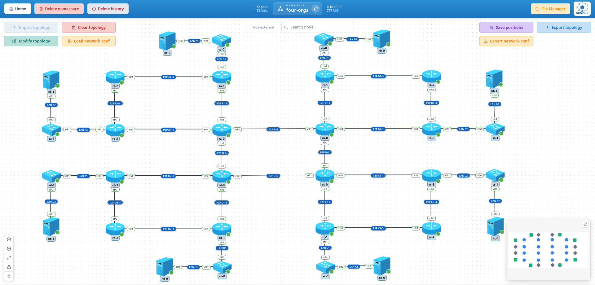

# 9-test-four-orgs-bgp

Four organizations, each with its own interior routing, joined in a ring by eBGP: organization A runs RIPv2, B runs OSPFv2, C runs IS-IS over IPv4, and D is IPv6-only on IS-IS and reaches the other three through NAT64 at its border. The example exercises:

- BGP, IS-IS and NAT64 on FRR, next to the RIP and OSPF of the earlier examples: four IGPs redistributed into one eBGP ring
- An IPv6-only organization whose hosts talk to IPv4 ones through the well known prefix `64:ff9b::/96`
- A 32 pod, 36 link topology deployed and configured from seven files, read back from the State tab of the node panel (BGP and IS-IS neighbours, routes) and the routers' consoles

## Topology Overview



Nodes deployed:

| Node | Driver | Image | Replicas | Role |
| --- | --- | --- | --- | --- |
| `ra` | `FRRRouterDriver` | `quay.io/frrouting/frr:10.7.1` | 4 | Organization A routers, RIPv2. `ra-0` is A's border router |
| `sa` | `OpenVSwitchDriver` | `globocom/openvswitch:latest` | 2 | Organization A switches, one per LAN |
| `ha` | `HostDriver` | `alpine:3.24.2` | 2 | Organization A hosts, one per LAN |
| `rb`, `sb`, `hb` | as above | as above | 4, 2, 2 | Organization B, OSPFv2 in area 0. `rb-0` is B's border router |
| `rc`, `sc`, `hc` | as above | as above | 4, 2, 2 | Organization C, IS-IS level 2 over IPv4. `rc-0` is C's border router |
| `rd`, `sd`, `hd` | as above | as above | 4, 2, 2 | Organization D, IPv6 only, IS-IS level 2 over IPv6. `rd-0` is D's border router and its NAT64 |

Every organization has the same shape: a square of four routers, `rX-0` to `rX-3`, with the border router `rX-0` holding the two ring links and the LANs hanging off `rX-1` and `rX-3`, each behind its own switch with one host. The diagram names the routers from 1 and Kubernetes numbers replicas from 0, so `ra-3` is RA4; the tables below use the pod names.

Organization A, `172.16.0.0/16`, AS 65001, RIPv2:

| Segment | Subnet | Ends |
| --- | --- | --- |
| LAN A1 | `172.16.1.0/24` | `ra-1 eth1` (`.1`), `ha-0` (`.10`) behind `sa-0` |
| LAN A2 | `172.16.2.0/24` | `ra-3 eth1` (`.1`), `ha-1` (`.10`) behind `sa-1` |
| RA1-RA2 | `172.16.255.0/30` | `ra-0 eth3` (`.1`), `ra-1 eth2` (`.2`) |
| RA2-RA3 | `172.16.255.4/30` | `ra-1 eth3` (`.5`), `ra-2 eth1` (`.6`) |
| RA3-RA4 | `172.16.255.8/30` | `ra-2 eth2` (`.9`), `ra-3 eth3` (`.10`) |
| RA4-RA1 | `172.16.255.12/30` | `ra-3 eth2` (`.13`), `ra-0 eth4` (`.14`) |

Organizations B (`172.17.0.0/16`, AS 65002, OSPFv2) and C (`172.18.0.0/16`, AS 65003, IS-IS) repeat the plan on their own block: the same LANs, links, interfaces and host numbers with `172.17` and `172.18` in place of `172.16`. B's OSPF router IDs are `172.17.0.1` to `172.17.0.4` for `rb-0` to `rb-3`; C's IS-IS NETs are `49.0003.0000.0000.0001.00` to `49.0003.0000.0000.0004.00` for `rc-0` to `rc-3`, area `49.0003`.

Organization D, `fd00:4::/32`, AS 65004, IS-IS over IPv6, NETs `49.0004.0000.0000.0001.00` to `49.0004.0000.0000.0004.00`:

| Segment | Subnet | Ends |
| --- | --- | --- |
| LAN D1 | `fd00:4:1::/64` | `rd-1 eth1` (`::1`), `hd-0` (`::10`) behind `sd-0` |
| LAN D2 | `fd00:4:2::/64` | `rd-3 eth1` (`::1`), `hd-1` (`::10`) behind `sd-1` |
| RD1-RD2 | `fd00:4:f1::/64` | `rd-0 eth3` (`::1`), `rd-1 eth2` (`::2`) |
| RD2-RD3 | `fd00:4:f2::/64` | `rd-1 eth3` (`::1`), `rd-2 eth1` (`::2`) |
| RD3-RD4 | `fd00:4:f3::/64` | `rd-2 eth2` (`::1`), `rd-3 eth3` (`::2`) |
| RD4-RD1 | `fd00:4:f4::/64` | `rd-3 eth2` (`::1`), `rd-0 eth4` (`::2`) |

D owns one IPv4 block, `172.19.0.0/24`, which nothing in D carries: it is the NAT64 pool of `rd-0`, the addresses its hosts borrow when they talk to the other organizations, and what `rd-0` announces to the ring. The translation prefix is the well known `64:ff9b::/96`, so from D the host `ha-0` is `64:ff9b::172.16.1.10`.

The ring, `172.31.0.0/28`, one /30 per border link:

| Link | Subnet | Ends |
| --- | --- | --- |
| A-B | `172.31.0.0/30` | `ra-0 eth2` (`.1`), `rb-0 eth1` (`.2`) |
| B-C | `172.31.0.4/30` | `rb-0 eth2` (`.5`), `rc-0 eth1` (`.6`) |
| C-D | `172.31.0.8/30` | `rc-0 eth2` (`.9`), `rd-0 eth1` (`.10`) |
| D-A | `172.31.0.12/30` | `rd-0 eth2` (`.13`), `ra-0 eth1` (`.14`) |

## Files In This Folder

- `topology-network-test-four-orgs-bgp.json`: the 32 nodes and 36 links of the four organizations, the ring included
- `network_conf_a_rip.json`: organization A: hosts, switches and RIP on the four routers
- `network_conf_b_ospf.json`: organization B: hosts, switches and OSPF in one area, every router link point-to-point
- `network_conf_c_isis.json`: organization C: hosts, switches and IS-IS level 2 over IPv4
- `network_conf_d_isis.json`: organization D: hosts with an IPv6 default route, switches and IS-IS level 2 over IPv6
- `network_conf_d_nat64.json`: NAT64 on `rd-0` and the translation prefix handed to D's IS-IS
- `network_conf_bgp.json`: eBGP on the four border routers, each trading its IGP for what the ring sends

Apply them in that order. After the first four each organization routes within itself and knows nothing of the others; the fifth gives D a way out; the sixth joins the four.

## Notable Characteristics

- Four interior protocols, each kept quiet towards the hosts in its own way: RIP with `rip_passive_interface` on the LAN, OSPF with `ospf_passive_default` and `ospf_no_passive` on the router links, IS-IS with `isis_passive_interface`. OSPF and IS-IS make every router link `point-to-point`, so no DR or DIS is elected on them.
- IS-IS runs level 2 only, one area per organization, and carries one address family per organization: `isis_add_interface` without `family` puts an interface in IS-IS for IPv4 (C), with `family: "6"` for IPv6 (D). The NET of each router ends in its replica number.
- Only the border routers speak BGP. Each one redistributes its IGP into BGP (`bgp_redistribute`) and BGP back into its IGP (`rip_redistribute`, `ospf_redistribute`, `isis_redistribute` with `bgp`), so the interior routers of A learn C's LANs as RIP routes, B's as OSPF `E2` routes, C's as IS-IS routes, with no idea the ring exists. The border's own links are not redistributed (`connected` would carry the pods' management network along), so a border's /30s stay private to its organization, as in example 8. `rd-0` announces its pool with `bgp_add_network` instead, since D has no IPv4 IGP to redistribute.
- NAT64 is tayga from the toolbox: `nat64_enable` with the pool creates the `nat64` tun device, routes the pool and the prefix into it and starts the translator, which takes the first pool address as its own. The prefix reaches `rd-1` to `rd-3` by `isis_redistribute` of the `kernel` routes for IPv6, so the hosts of D route `64:ff9b::/96` to the border like any other prefix. A host of A answers to a pool address, which the ring carries back to `rd-0`.
- The ring gives every pair of organizations two paths. BGP prefers the shorter AS path, so A reaches B and D directly and C through one of them; which one is the tie-break between two equal paths, visible in `show ip bgp` on `ra-0`.
- Nothing in D but `rd-0` has an IPv4 address on the topology (the pods keep their IPv4 `eth0` for Kubernetes). The hosts ping, trace and fetch over IPv6 only.

## Step-By-Step (UI)

### 1. Create namespace

Create a namespace (e.g. `four-orgs` or any name you prefer).

### 2. Import topology

- Go to the namespace graph view.
- Click **Import topology**.
- Select `topology-network-test-four-orgs-bgp.json`.
- Wait until the 32 nodes are running (about a minute).

### 3. Organization A: RIPv2

- Click **Load network conf** and select `network_conf_a_rip.json`.
- Open the panel of `ra-2`, tab **State**, section **RIP routes**: both LANs and the two far links, within a RIP update (30 s). The same from the console:

  ```bash
  vtysh -c "show ip rip"
  ```

- From `ha-0` (LAN A1), reach LAN A2:

  ```bash
  ping -c 3 172.16.2.10
  ```

### 4. Organization B: OSPFv2

- Load `network_conf_b_ospf.json`.
- Panel of `rb-2`, **State**, **OSPF neighbors**: `rb-1` and `rb-3` in `Full/-`, the point-to-point state. **OSPF interfaces** shows `eth1` and `eth2` as `point-to-point`.
- From `hb-0`:

  ```bash
  ping -c 3 172.17.2.10
  ```

### 5. Organization C: IS-IS over IPv4

- Load `network_conf_c_isis.json`.
- Panel of `rc-2`, **State**, **IS-IS neighbors**: `rc-1` and `rc-3` at level 2, state `Up`. From the console, the adjacencies and what IS-IS put in the table:

  ```bash
  vtysh -c "show isis neighbor"
  vtysh -c "show ip route isis"
  ```

- From `hc-0`:

  ```bash
  ping -c 3 172.18.2.10
  ```

### 6. Organization D: IS-IS over IPv6

- Load `network_conf_d_isis.json`.
- Panel of `rd-2`, **State**, **IS-IS neighbors**: the same picture as in C. The routes are IPv6:

  ```bash
  vtysh -c "show ipv6 route isis"
  ```

- From `hd-0`, reach LAN D2:

  ```bash
  ping -c 3 fd00:4:2::10
  ```

### 7. NAT64 at D's border

- Load `network_conf_d_nat64.json`.
- On `rd-0`, the translator and its routes:

  ```bash
  ip addr show nat64
  ip route show 172.19.0.0/24
  ip -6 route show 64:ff9b::/96
  ```

  Expected: the `nat64` tun device up, the pool and the prefix routed into it (`K` routes in `vtysh -c "show ip route"` and `show ipv6 route`).

- On `rd-2`, the prefix arrived by IS-IS:

  ```bash
  vtysh -c "show ipv6 route 64:ff9b::/96"
  ```

  Nothing answers through it yet: the pool is not announced anywhere until the ring is up.

### 8. The ring

- Load `network_conf_bgp.json`.
- Panel of any border router, **State**, **BGP neighbors**: two neighbours `Established` with prefixes received on both. From `ra-0`'s console, the whole table:

  ```bash
  vtysh -c "show bgp summary"
  vtysh -c "show ip bgp"
  ```

  Expected: B's and D's prefixes with an AS path of one hop, C's with two; `172.19.0.0/24` from AS 65004 is all that D announces.

- On `ra-2`, the rest of the world arrives through RIP; on `rb-1` as `E2` routes; on `rc-2` as IS-IS routes:

  ```bash
  vtysh -c "show ip rip"              # on ra-2
  vtysh -c "show ip ospf route"       # on rb-1
  vtysh -c "show ip route isis"       # on rc-2
  ```

- End to end over IPv4:

  ```bash
  ping -c 3 172.17.2.10    # from ha-0 to hb-1
  ping -c 3 172.18.2.10    # from hb-0 to hc-1
  ping -c 3 172.16.2.10    # from hc-0 to ha-1, two ASes away
  ```

- From D, IPv6 only, through NAT64:

  ```bash
  ping -c 3 64:ff9b::172.16.1.10    # from hd-0 to ha-0
  ping -c 3 64:ff9b::172.18.2.10    # from hd-1 to hc-1
  ```

- Capture on `rd-0 eth2` (the D-A link) from the node's or the link's menu while `hd-0` pings: the packets on the wire are IPv4, from a `172.19.0.x` address of the pool to `172.16.1.10`, and the replies come back to the pool. Capture on `rd-0 eth3` for the IPv6 side of the same exchange.
- Trace from `hd-0` to `64:ff9b::172.16.1.10` from the **Tools** menu, or `traceroute6 -n 64:ff9b::172.16.1.10` from its shell: `rd-1` and `rd-0` over IPv6, the translator itself (`fd64:ac13::1`, tayga's own address), `rd-0` again on its IPv4 side, then `ra-0` as `64:ff9b::172.31.0.14`, `ra-1` as `64:ff9b::172.16.255.2` and the host. Every IPv4 hop answers as an address under the prefix: the ICMP errors are translated too. The IPv4 hop of `rd-0` shows the pod's own `eth0` address, the only IPv4 one the kernel can pick for a packet leaving through the tun device.

## Experiments

- **Break the ring.** Disable `ra-0 eth2` (the A-B link) from the interface menu: `ra-0` loses its session with `rb-0` and B's prefixes come back through D and C with an AS path of three. A trace from `ha-0` to `hb-1` goes around the ring. Enable the interface again and the direct path returns.
- **Restart the NAT64.** Restart `rd-0` from its menu: IS-IS, BGP and the translator are replayed, the two sessions come back and `hd-0` reaches `ha-0` again within a minute.
- **An IPv6 island.** Remove the NAT64 (`nat64_disable` on `rd-0` through **Load network conf**): D keeps routing inside and loses the other three, since nothing in D has an IPv4 address to send from.

## Troubleshooting

- An IS-IS neighbour stuck in `Init` on the State tab has the two ends in different families or levels: both need `isis_add_interface` with the same `family` and a level the router runs (`level-2` here). The LSP MTU is 1277 on purpose, the lowest the standard allows, so links below 1500 never drop LSPs.
- A BGP neighbour in `Active` or `Connect` has the wrong address or AS on one end: the neighbour is the far end's ring address and the remote AS its organization's.
- If `hd-0` cannot reach `64:ff9b::172.16.1.10`, check in this order: `ip -6 route` on `rd-2` holds `64:ff9b::/96` by IS-IS (the `kernel` redistribution on `rd-0`), `show ip bgp 172.19.0.0/24` on `ra-0` has the pool, and `tayga` is running on `rd-0` (`pgrep tayga` in its toolbox). The platform starts tayga with `wkpf-strict no`, so private IPv4 addresses behind the well known prefix are translated, which a stock tayga refuses.
- The hosts of D resolve nothing: no DNS64 here. Use addresses, `64:ff9b::` followed by the IPv4 one.

> Last reviewed: 1 Nov 2026
